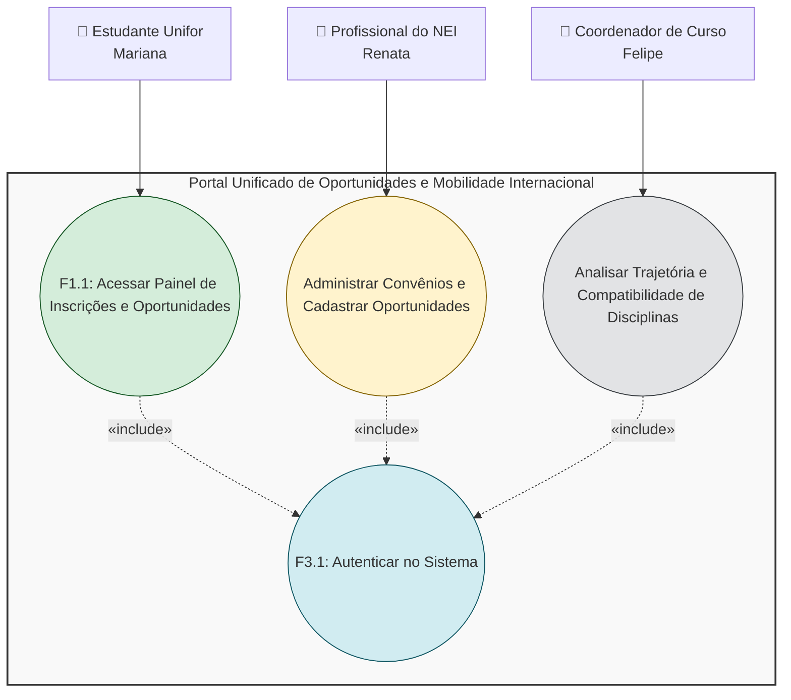
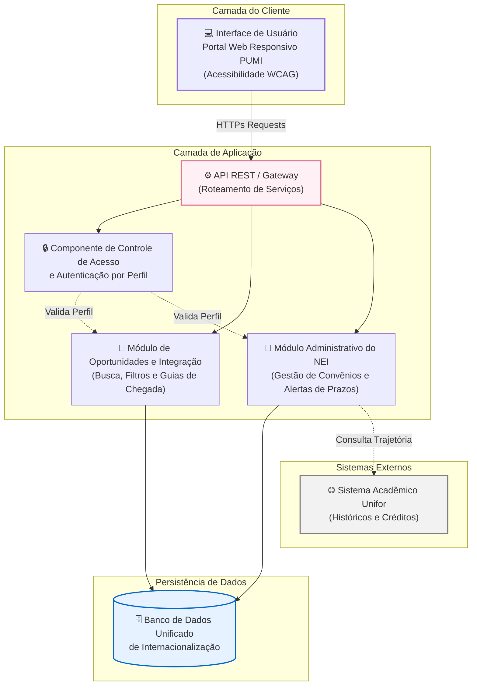
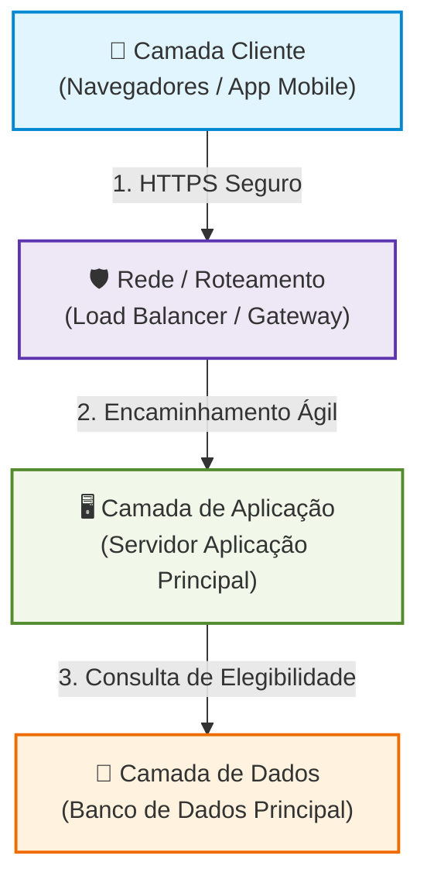

# T193-16 Requisitos Mod de Sistemas 
_Grupo 3 | Prof. Marcelo Bezerra de Alcântara_

## 💼 Equipe:
- Nicholas Marques A.
- Diego Alexander
- Ycaro Vieira
- Charles Targino

## 🌐 Projeto Internacionalização 
-> _Desenvolvido conforme sugestões 3 e 4 do documento Propostas_Projetos_Internacionalizacao_ENADE_Unifor.docx_

