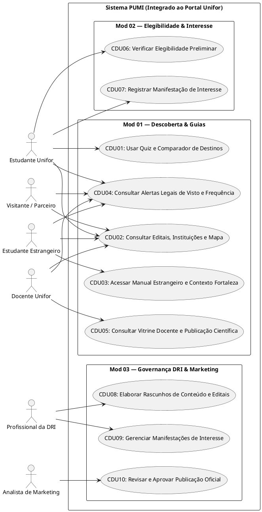

# Arquitetura e Artefatos Complementares — Portal Unificado de Oportunidades e Mobilidade Internacional (PUMI)

**Instituição:** Universidade de Fortaleza (Unifor)  
**Disciplina / Contexto:** T193-16 — Requisitos e Modelagem de Sistemas  

---

## 1. Visão Arquitetural de Alto Nível

O **PUMI** é estruturado como uma aplicação web responsiva integrada ao portal institucional da **Unifor**, composta por:

* **Camada de Apresentação Web:** páginas e jornadas responsivas (*Estude Mundo Afora com a Unifor*, *Do Mundo para a Unifor*, *Docentes e Pesquisa Internacional*) e painéis administrativos (*DRI* e *Marketing*), aplicando identidade visual institucional e diretrizes WCAG.
* **Camada de Aplicação / API:** regras de negócio de filtragem, cálculo de afinidade do quiz, verificação preliminar de elegibilidade, geração de protocolo de manifestação de interesse e máquina de estados do fluxo editorial (*Rascunho* -> *Aguardando Aprovação do Marketing* -> *Publicado* / *Ajustes Solicitados* / *Arquivado*).
* **Camada de Dados Relacional:** persistência estruturada de oportunidades, instituições conveniadas, fichas de destinos, guias, curadoria docente, indicadores agregados, manifestações de interesse e trilhas de auditoria.
* **Integrações Institucionais (a validar com TI):** serviço de autenticação institucional (SSO) e canais/formulários oficiais externos de candidatura formal.

---

## 2. Diagrama de Casos de Uso e Governança (PlantUML)



---

## 3. Organização do Repositório de Requisitos (Padrão LAPIS)

```text
Requisitos/
├── README.md
├── Elicitacao/
│   └── Elicitacao.md
├── Especificacao de Casos de Uso/
│   ├── CDU01-usar-quiz-e-comparador-de-destinos/
│   │   └── CDU01-usar-quiz-e-comparador-de-destinos.md
│   ├── ...
│   └── CDU10-revisar-e-aprovar-publicacao-oficial/
│       └── CDU10-revisar-e-aprovar-publicacao-oficial.md
├── Especificacao de Regra de Negocio/
│   └── Especificacao-de-Regras-de-Negocio.md
├── Requisito Nao Funcionais/
│   └── Requisitos-Nao-Funcionais.md
└── Artefatos/
    └── Arquitetura-e-Artefatos-Complementares.md
```
