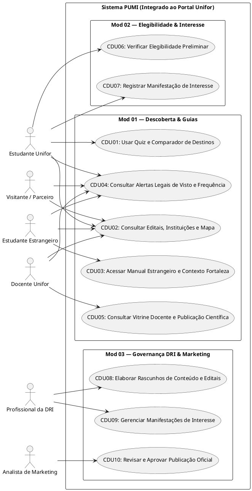

# Casos de Uso — Portal Unificado de Oportunidades e Mobilidade Internacional (PUMI)

Catálogo estruturado das especificações de **Casos de Uso (CDU)** do sistema **PUMI** (Universidade de Fortaleza — Unifor / DRI), modeladas a partir da **Visão da Demanda (v2.0)** e estruturadas conforme o template padrão **LAPIS**.

---

## Catálogo de Casos de Uso

| ID | Caso de Uso | Módulo | Ator Primário | Rastreabilidade (Func. / RN) |
| --- | --- | --- | --- | --- |
| **CDU01** (`UC1`) | [Usar Quiz e Comparador de Destinos](./CDU01-usar-quiz-e-comparador-de-destinos/CDU01-usar-quiz-e-comparador-de-destinos.md) | Mod 01 — Descoberta & Guias | Estudante Unifor | F1.2, F1.3 \| RN02, RN05 |
| **CDU02** (`UC2`) | [Consultar Editais, Instituições e Mapa](./CDU02-consultar-editais-instituicoes-e-mapa/CDU02-consultar-editais-instituicoes-e-mapa.md) | Mod 01 — Descoberta & Guias | Visitante / Usuário do Portal | F1.1, F1.4, F1.6, F2.5 \| RN01, RN02, RN05 |
| **CDU03** (`UC3`) | [Acessar Manual Estrangeiro e Contexto Fortaleza](./CDU03-acessar-manual-estrangeiro-e-contexto-fortaleza/CDU03-acessar-manual-estrangeiro-e-contexto-fortaleza.md) | Mod 01 — Descoberta & Guias | Estudante Estrangeiro | F2.2, F2.5 \| RN01, RN03, RN04, RN07 |
| **CDU04** (`UC4`) | [Consultar Alertas Legais de Visto e Frequência](./CDU04-consultar-alertas-legais-visto-e-frequencia/CDU04-consultar-alertas-legais-visto-e-frequencia.md) | Mod 01 — Descoberta & Guias | Usuário / Candidato à Mobilidade | F2.1, F2.3 \| RN01, RN03, RN04, RN05, RN07 |
| **CDU05** (`UC5`) | [Consultar Vitrine Docente e Publicação Científica](./CDU05-consultar-vitrine-docente-e-publicacao-cientifica/CDU05-consultar-vitrine-docente-e-publicacao-cientifica.md) | Mod 01 — Descoberta & Guias | Docente Unifor | F1.5, F2.5 \| RN01, RN02, RN05 |
| **CDU06** (`UC6`) | [Verificar Elegibilidade Preliminar](./CDU06-verificar-elegibilidade-preliminar/CDU06-verificar-elegibilidade-preliminar.md) | Mod 02 — Elegibilidade & Interesse | Estudante Unifor | F2.4 \| RN02, RN06 |
| **CDU07** (`UC7`) | [Registrar Manifestação de Interesse](./CDU07-registrar-manifestacao-de-interesse/CDU07-registrar-manifestacao-de-interesse.md) | Mod 02 — Elegibilidade & Interesse | Estudante Unifor | F3.1, F2.5 \| RN01, RN02, RN05 |
| **CDU08** (`UC8`) | [Elaborar Rascunhos de Conteúdo e Editais](./CDU08-elaborar-rascunhos-de-conteudo-e-editais/CDU08-elaborar-rascunhos-de-conteudo-e-editais.md) | Mod 03 — Governança DRI & Marketing | Profissional da DRI | F3.3, F3.5 \| RN01, RN02, RN03, RN04, RN05, RN07 |
| **CDU09** (`UC9`) | [Gerenciar Manifestações de Interesse](./CDU09-gerenciar-manifestacoes-de-interesse/CDU09-gerenciar-manifestacoes-de-interesse.md) | Mod 03 — Governança DRI & Marketing | Profissional da DRI | F3.2 \| RN02 |
| **CDU10** (`UC10`) | [Revisar e Aprovar Publicação Oficial](./CDU10-revisar-e-aprovar-publicacao-oficial/CDU10-revisar-e-aprovar-publicacao-oficial.md) | Mod 03 — Governança DRI & Marketing | Analista de Marketing | F3.4, F3.5 \| RN01, RN02, RN03, RN04, RN07 |

---

## Diagrama de Casos de Uso e Governança



---

## Estrutura de Pastas no Repositório

```text
├── README.md
├── CDU01-usar-quiz-e-comparador-de-destinos/
│   └── CDU01-usar-quiz-e-comparador-de-destinos.md
├── CDU02-consultar-editais-instituicoes-e-mapa/
│   └── CDU02-consultar-editais-instituicoes-e-mapa.md
├── CDU03-acessar-manual-estrangeiro-e-contexto-fortaleza/
│   └── CDU03-acessar-manual-estrangeiro-e-contexto-fortaleza.md
├── CDU04-consultar-alertas-legais-visto-e-frequencia/
│   └── CDU04-consultar-alertas-legais-visto-e-frequencia.md
├── CDU05-consultar-vitrine-docente-e-publicacao-cientifica/
│   └── CDU05-consultar-vitrine-docente-e-publicacao-cientifica.md
├── CDU06-verificar-elegibilidade-preliminar/
│   └── CDU06-verificar-elegibilidade-preliminar.md
├── CDU07-registrar-manifestacao-de-interesse/
│   └── CDU07-registrar-manifestacao-de-interesse.md
├── CDU08-elaborar-rascunhos-de-conteudo-e-editais/
│   └── CDU08-elaborar-rascunhos-de-conteudo-e-editais.md
├── CDU09-gerenciar-manifestacoes-de-interesse/
│   └── CDU09-gerenciar-manifestacoes-de-interesse.md
└── CDU10-revisar-e-aprovar-publicacao-oficial/
    └── CDU10-revisar-e-aprovar-publicacao-oficial.md
```
