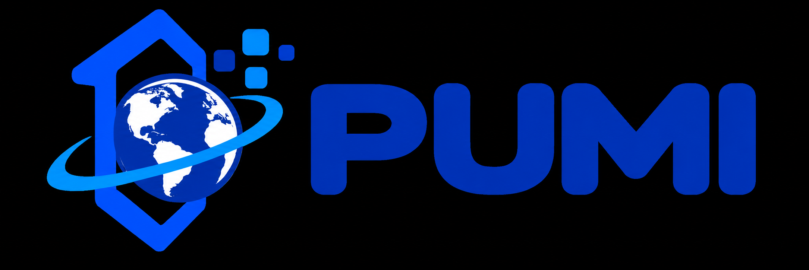

## 📖 Glossário de Termos

## Histórico de Versões

| Data | Versão | Descrição | Autor |
|---|---:|---|---|
| 01/11/2026 | 1.0 | Criação inicial do glossário do PUMI. | Equipe 3 - Nicholas |
| 03/11/2026 | 1.1 | Atualização com base na Visão da Demanda atual, incluindo públicos, jornadas, módulos, requisitos, arquitetura e escopo do MVP. | Equipe 3 |

## Glossário do Projeto

Glossário de termos, siglas e expressões utilizados no Portal Unificado de Oportunidades e Mobilidade Internacional (PUMI). As definições refletem a Visão da Demanda atual; decisões identificadas como dependentes de validação institucional permanecem condicionais.

| Termo/Sigla | Definição | Fonte/Observação |
|---|---|---|
| PUMI | Portal Unificado de Oportunidades e Mobilidade Internacional; aplicação web proposta para centralizar informações, oportunidades e orientações sobre internacionalização acadêmica vinculada à Unifor. | Visão da Demanda atual |
| Unifor | Universidade de Fortaleza, instituição à qual o PUMI está vinculado. | Visão da Demanda atual |
| Internacionalização acadêmica | Iniciativas e experiências que conectam a comunidade acadêmica a instituições, estudos e oportunidades de outros países, incluindo mobilidade de saída e de entrada. | Visão da Demanda atual |
| Mobilidade internacional | Experiência acadêmica realizada temporariamente em outro país ou em instituição estrangeira, conforme o programa e as regras aplicáveis. | Visão da Demanda atual; definição geral do contexto |
| Mobilidade de saída | Jornada voltada a pessoas vinculadas à Unifor que desejam estudar ou realizar atividades acadêmicas no exterior. | Visão da Demanda atual |
| Mobilidade de entrada | Jornada voltada a estudantes ou instituições estrangeiras interessados em estudar ou realizar atividades acadêmicas na Unifor. | Visão da Demanda atual |
| DRI | Diretoria de Relações Internacionais; área responsável por validar informações oficiais e, no PUMI proposto, administrar oportunidades, conteúdos, calendários e manifestações de interesse. | Visão da Demanda atual |
| Estudante da Unifor | Estudante vinculado à Universidade de Fortaleza que pode consultar oportunidades, verificar preliminarmente critérios e registrar interesse em programas de mobilidade. | Visão da Demanda atual |
| Estudante estrangeiro / candidato internacional | Pessoa vinculada a instituição ou país estrangeiro que busca informações sobre estudar ou realizar mobilidade na Unifor. | Visão da Demanda atual |
| Docente | Professor da Unifor que consulta programas, parcerias e possibilidades de mobilidade ou cooperação acadêmica. | Visão da Demanda atual |
| Visitante / público externo | Pessoa que consulta informações públicas sobre a internacionalização da Unifor sem necessariamente possuir cadastro. | Visão da Demanda atual |
| Instituição conveniada | Instituição que mantém convênio ou acordo pertinente à mobilidade ou cooperação internacional com a Unifor. As informações oficiais devem ser validadas pela DRI. | Visão da Demanda atual |
| Oportunidade internacional | Programa, edital, bolsa, intercâmbio, dupla titulação ou outra iniciativa internacional divulgada no PUMI. | Visão da Demanda atual |
| Edital | Documento que descreve condições, critérios, prazos, documentação e orientações de participação em uma oportunidade. | Visão da Demanda atual |
| Bolsa | Auxílio financeiro associado a uma oportunidade, conforme condições descritas no edital ou nas informações oficiais. | Visão da Demanda atual |
| Programa de intercâmbio | Programa que possibilita uma experiência de mobilidade acadêmica conforme regras e acordos institucionais. | Visão da Demanda atual |
| Dupla titulação | Percurso acadêmico que pode resultar em titulações de instituições participantes, de acordo com o programa e os acordos aplicáveis. | Visão da Demanda atual |
| Catálogo de oportunidades | Área do PUMI que lista oportunidades publicadas e permite localizá-las e compará-las por filtros e detalhes. | Visão da Demanda atual |
| Catálogo de instituições | Relação consultável das instituições conveniadas, com informações públicas e oportunidades relacionadas. | Visão da Demanda atual |
| Mapa-múndi | Recurso cartográfico simplificado do PUMI, com marcadores de instituições, filtro por continente e cartões informativos. Complementa, mas não substitui, a listagem textual. | Visão da Demanda atual |
| Calendário de inscrições | Recurso que apresenta períodos de inscrição divulgados, incluindo janela atual quando vigente, período anterior mais recente e próxima janela informada. | Visão da Demanda atual |
| Janela de inscrição | Intervalo de datas em que uma oportunidade aceita inscrições ou manifestações, conforme informação oficial cadastrada. | Visão da Demanda atual |
| Critério de elegibilidade | Condição definida para uma oportunidade que deve ser considerada ao avaliar se uma pessoa aparentemente atende aos requisitos publicados. | Visão da Demanda atual |
| Elegibilidade preliminar | Comparação orientativa entre dados informados pelo estudante e critérios cadastrados. Não constitui aprovação, seleção nem decisão oficial da Unifor. | Visão da Demanda atual |
| PMG | Sigla mencionada na Visão da Demanda como possível critério acadêmico. Seu significado institucional, cálculo e eventual valor mínimo devem ser confirmados com a DRI antes de implementação. | Visão da Demanda atual; validação institucional pendente |
| Manifestação de interesse | Registro simplificado pelo qual estudante autenticado da Unifor demonstra interesse em uma oportunidade para iniciar contato organizado com a DRI. Não equivale à candidatura oficial. | Visão da Demanda atual |
| Protocolo | Identificador gerado para localizar e consultar uma manifestação de interesse registrada. | Visão da Demanda atual |
| Situação da manifestação | Estado operacional do registro de interesse. A Visão da Demanda propõe estados como “Recebida”, “Em orientação”, “Concluída” e “Cancelada”. | Visão da Demanda atual |
| Candidatura oficial / formal | Inscrição realizada pelo procedimento formal indicado pela instituição ou pelo edital. No MVP, pode ocorrer em formulário ou canal externo ao PUMI. | Visão da Demanda atual |
| MVP | Produto Mínimo Viável: primeira versão funcional, com recursos essenciais para validar a proposta com usuários e stakeholders. | Visão da Demanda atual |
| Stakeholder / parte interessada | Pessoa, grupo ou área que influencia o projeto, participa dele ou é afetada por seus resultados. | Visão da Demanda atual |
| Persona | Perfil de referência que representa necessidades e objetivos de um tipo de usuário; as personas do documento são propostas e não entrevistas já realizadas. | Visão da Demanda atual |
| Requisito funcional | Descrição de uma capacidade ou comportamento que o sistema deve oferecer. | Visão da Demanda atual |
| Requisito não funcional | Requisito relacionado à qualidade ou restrição do sistema, como acessibilidade, segurança, responsividade ou desempenho. | Visão da Demanda atual |
| Acessibilidade | Condição de uso do portal por pessoas com diferentes capacidades e necessidades, incluindo navegação por teclado, contraste e estrutura semântica. | Visão da Demanda atual |
| WCAG | Web Content Accessibility Guidelines; diretrizes de acessibilidade para conteúdo e interfaces web citadas pela Visão da Demanda. | Visão da Demanda atual |
| Responsividade | Adaptação da interface a diferentes tamanhos de tela e dispositivos, incluindo celular, tablet e computador. | Visão da Demanda atual |
| LGPD | Lei Geral de Proteção de Dados Pessoais; legislação brasileira de referência para o tratamento de dados pessoais. | Visão da Demanda atual |
| Dado pessoal | Informação relacionada a pessoa natural identificada ou identificável. O PUMI deve limitar a coleta ao necessário e informar finalidade e tratamento. | Visão da Demanda atual; LGPD |
| Dado acadêmico | Informação relativa à trajetória acadêmica, solicitada apenas quando necessária à funcionalidade e conforme tratamento autorizado. | Visão da Demanda atual |
| Autenticação | Processo de confirmar a identidade de quem acessa uma área restrita do sistema. | Visão da Demanda atual |
| Autenticação institucional | Autenticação por serviço da Unifor, desejável para estudantes e administradores, cuja viabilidade depende de documentação e autorização da área de TI. | Visão da Demanda atual; dependência a validar |
| Perfil de acesso | Categoria de usuário usada para determinar permissões, como visitante, estudante autenticado ou administrador DRI. | Visão da Demanda atual |
| Controle de acesso | Regras que restringem áreas e operações conforme o perfil e as permissões do usuário. | Visão da Demanda atual |
| Painel administrativo DRI | Área restrita na qual usuários autorizados da DRI gerenciam oportunidades, instituições, calendários, conteúdos e manifestações. | Visão da Demanda atual |
| Governança de conteúdo | Responsabilidades e procedimentos para validar, publicar, revisar e manter atualizadas as informações do portal. | Visão da Demanda atual |
| Histórico de alterações | Registro básico de usuário e data das principais alterações administrativas, como publicação, edição ou encerramento de oportunidade. | Visão da Demanda atual |
| API | Interface de programação que permite a comunicação entre componentes da aplicação ou com serviços externos. A arquitetura proposta prevê uma API/camada de aplicação. | Visão da Demanda atual |
| Banco de dados relacional | Base estruturada em tabelas relacionadas, proposta para armazenar usuários, oportunidades, instituições, critérios, calendários, conteúdos e manifestações. | Visão da Demanda atual |
| Integração institucional | Conexão do PUMI com sistemas ou serviços da Unifor, como autenticação. Sua disponibilidade depende de autorização e viabilidade técnica. | Visão da Demanda atual |
| Formulário externo | Formulário ou canal oficial fora do PUMI para realização da candidatura formal, quando assim definido pela DRI. | Visão da Demanda atual |
| Scrum | Framework ágil indicado para organizar o desenvolvimento iterativo do PUMI por meio de Sprints e inspeção dos resultados. | Visão da Demanda atual |
| Product Owner | Papel responsável por maximizar o valor do produto e ordenar o Product Backlog. A representação e atribuição desse papel no projeto devem ser acordadas pela equipe. | Terminologia Scrum; aplicação a definir no projeto |
| Scrum Master | Papel que apoia a adoção do Scrum e ajuda a equipe a remover impedimentos. | Terminologia Scrum |
| Product Backlog | Lista ordenada de necessidades, funcionalidades, melhorias e correções do produto. | Terminologia Scrum |
| Sprint | Período de trabalho com duração definida em que a equipe busca produzir um incremento utilizável. | Terminologia Scrum |
| Incremento | Resultado integrado e utilizável que acrescenta valor ao produto. | Terminologia Scrum |
| História de usuário | Forma de descrever uma necessidade do ponto de vista de um usuário, frequentemente no formato “Como…, quero…, para…”. | Visão da Demanda atual |
| Critério de aceitação | Condição verificável usada para avaliar se uma história ou funcionalidade atende ao comportamento esperado. | Visão da Demanda atual |
| Prioridade Must / Should / Could | Classificação sugerida na Visão da Demanda para indicar prioridade relativa das funcionalidades; a priorização final deve ser revista com o Product Owner. | Visão da Demanda atual |
| HTTPS | Protocolo seguro de comunicação previsto nos diagramas de implantação para conexões entre navegador e aplicação. | Visão da Demanda atual |
| Conteúdo bilíngue | Conteúdo disponibilizado em português e inglês; no MVP, a Visão da Demanda prioriza páginas e orientações essenciais em inglês. | Visão da Demanda atual |
| Fora do escopo do MVP | Funcionalidade que não será implementada na primeira versão. A Visão da Demanda exclui candidatura formal, upload de documentos e análise documental dentro do PUMI. | Visão da Demanda atual |
| Proposta a validar | Decisão sugerida no documento que depende de confirmação da DRI ou de áreas responsáveis da Unifor antes de ser tratada como regra definitiva. | Nota de elaboração da Visão da Demanda atual |
