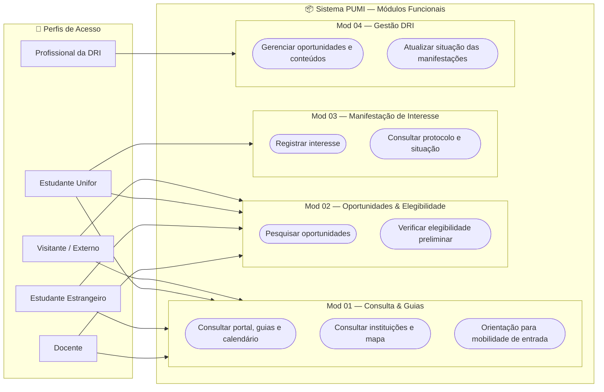
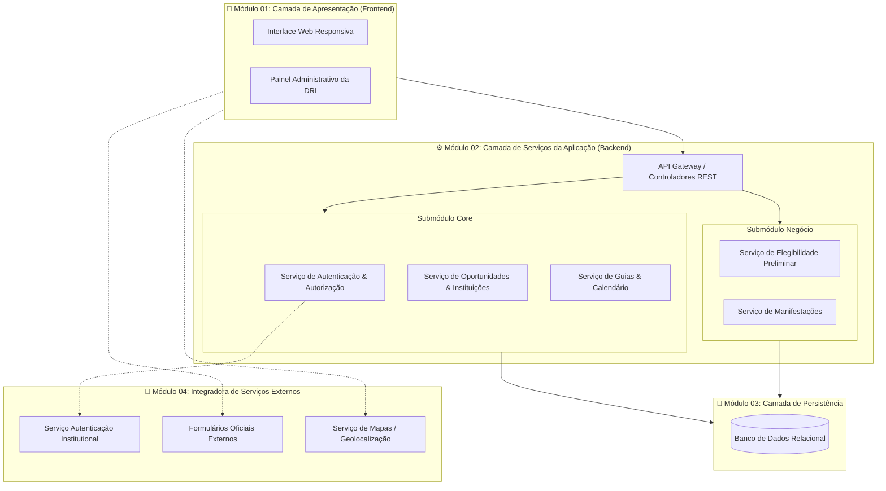
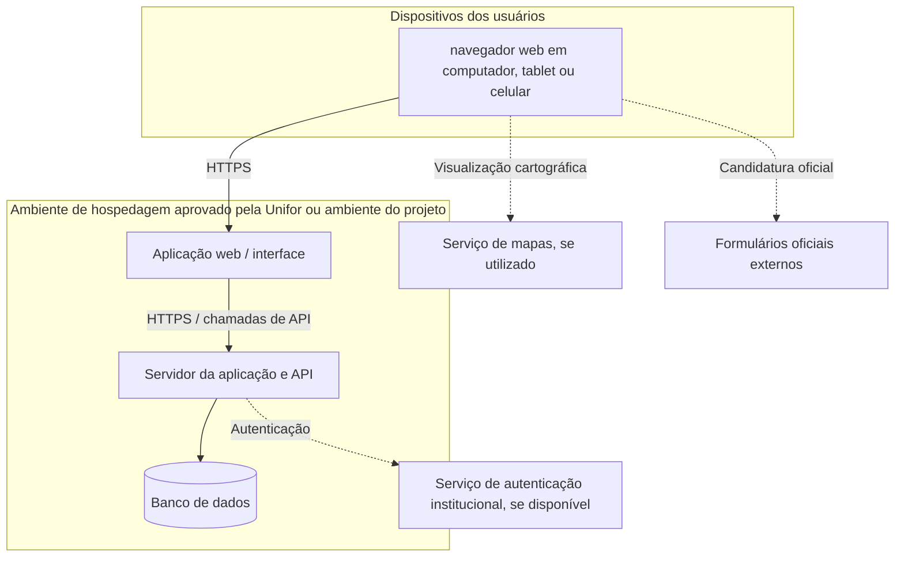
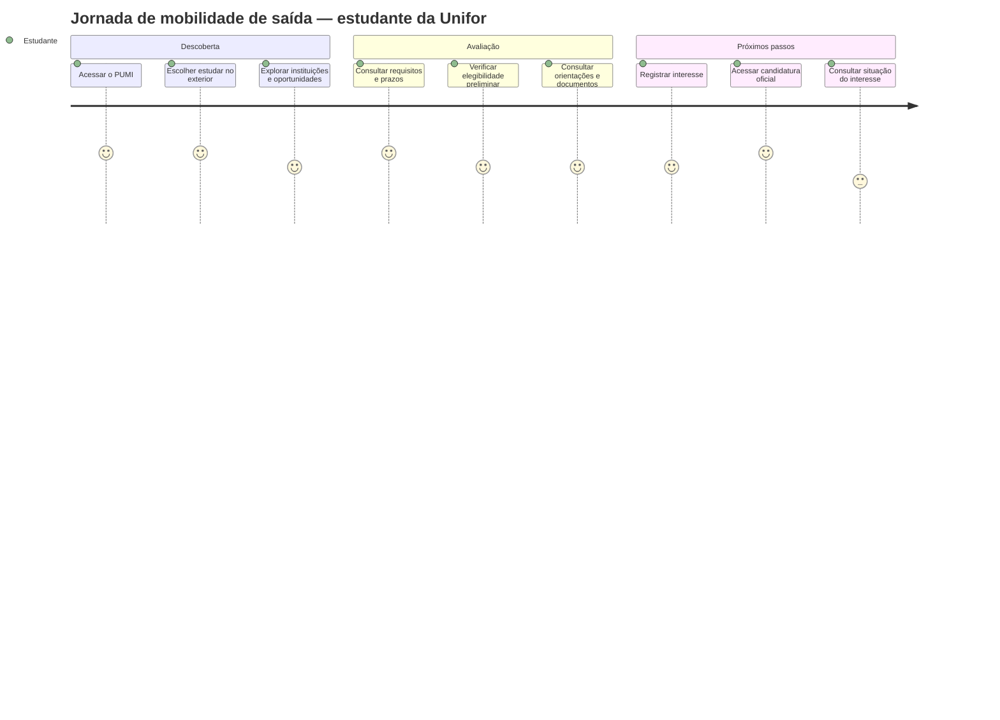

# Visão da Demanda (VD)

## Portal Unificado de Oportunidades e Mobilidade Internacional (PUMI)

**Instituição:** Universidade de Fortaleza (Unifor)  
**Disciplina / contexto:** T193-16 — Requisitos e Modelagem de Sistemas  
**Metodologia de desenvolvimento:** Scrum  

---

## Histórico de versões

| Data | Versão | Descrição | Autor |
|---|---:|---|---|
| 29/10/2026 | 1.0 | Criação inicial da visão da demanda do PUMI. | Equipe 3 — Nicholas |
| 01/11/2026 | 1.1 | Revisão da visão, consolidação das sugestões 3 (Gestão de Oportunidades Internacionais) e 4 (Portal de Internacionalização), preenchimento das lacunas e delimitação da Visão de Demanda para um MVP adequado ao Scrum. | Equipe 3 |
| 10/11/2026 | 1.2 | Ajuste da persona da DRI e alinhamento dos perfis de acesso, funcionalidades, diagramas e histórias de usuário ao uso compartilhado do painel administrativo pelos profissionais da área. | Equipe 3 |

> **Nota de elaboração:** esta versão transforma a concepção inicial em uma proposta de produto. Os itens identificados como **proposta a validar** são decisões sugeridas para orientar o desenvolvimento e precisam ser confirmados com a DRI e, quando aplicável, com as áreas responsáveis da Unifor. Em especial, critérios acadêmicos, períodos oficiais, disponibilidade de integrações e regras de tratamento de dados não devem ser considerados definitivos sem validação institucional.

## 1. Objetivo
Definir a visão, a proposta de valor, o escopo e as necessidades dos principais públicos do **Portal Unificado de Oportunidades e Mobilidade Internacional (PUMI)**, uma aplicação web de apoio à internacionalização acadêmica vinculada à Unifor.

O PUMI deverá centralizar, em um único ambiente, informações sobre oportunidades internacionais, instituições conveniadas, editais, bolsas, períodos de inscrição e orientações para a mobilidade acadêmica. O portal atenderá tanto pessoas vinculadas à Unifor — especialmente estudantes e docentes interessados em experiências no exterior — quanto estudantes e instituições estrangeiras que desejem conhecer ou realizar atividades acadêmicas na Unifor. Também deverá permitir que qualquer pessoa interessada consulte informações públicas sobre a internacionalização da Universidade.

O papel do sistema é **centralizar, simplificar e apoiar a internacionalização acadêmica ao gerenciar editais e bolsas, facilitar a descoberta de oportunidades, orientar a elegibilidade e organizar o contato inicial com a DRI.**

## 2. Proposta de Valor

### 2.1. Visão

Ser o ponto de entrada digital da internacionalização da Unifor: um portal claro, acessível e confiável no qual cada pessoa encontre um caminho adequado ao seu interesse — **estudar no exterior com a Unifor**, **vir estudar na Unifor** ou simplesmente **conhecer as oportunidades internacionais da Universidade**.

### 2.2. Proposta de valor

O PUMI reúne duas frentes complementares:

1. **Gestão de Oportunidades Internacionais (Sugestão 3):** organiza editais, bolsas, programas de intercâmbio, dupla titulação e outras oportunidades, apresentando instituições, requisitos, vagas quando informadas, prazos, documentação e links para os processos oficiais. Para estudantes da Unifor, oferece uma verificação preliminar dos critérios informados e a possibilidade de registrar interesse em uma oportunidade.
2. **Portal de Internacionalização (Sugestão 4):** reúne orientações para estudantes que desejam sair do país e para estrangeiros que desejam estudar na Unifor, incluindo informações sobre candidatura, documentação, vistos, proficiência, custos estimados, hospedagem, aproveitamento acadêmico e canais de atendimento.

Com isso, espera-se:

- reduzir a dispersão de informações atualmente consultadas em diferentes páginas, editais, documentos e canais;
- facilitar a descoberta e a comparação de oportunidades;
- dar maior visibilidade a prazos, requisitos e períodos de inscrição;
- reduzir dúvidas repetitivas e retrabalho no atendimento da DRI;
- oferecer mais transparência sobre as etapas de interesse e orientação;
- ampliar a divulgação internacional da Unifor e tornar mais simples o primeiro contato de estudantes estrangeiros;
- dar à DRI um espaço administrável para manter informações atualizadas, sem depender de alterações manuais no código da aplicação.

## 3. Descrição da Demanda
A demanda consiste em desenvolver uma aplicação web responsiva que funcione como um **hub digital de internacionalização**, organizado por jornadas de usuário e sustentado por um painel administrativo de conteúdo.

### 3.1. Públicos e jornadas principais

- **Estude mundo afora com a Unifor:** estudantes da Unifor consultam instituições conveniadas, editais, vagas, requisitos, calendário e orientações para mobilidade de saída. Quando aplicável, podem realizar uma verificação preliminar de elegibilidade e registrar interesse.
- **Do mundo para a Unifor:** estudantes estrangeiros encontram orientações para estudar na Universidade, informações sobre candidatura, documentação, calendário, vida acadêmica e canais de contato. O portal apresenta o caminho institucional para a candidatura, sem tentar substituir os procedimentos oficiais.
- **Conheça a internacionalização da Unifor:** visitantes, familiares, docentes, instituições parceiras e demais interessados acessam informações públicas sobre programas, parcerias e oportunidades.
- **Gerencie o portal:** profissionais da DRI utilizam o painel administrativo para cadastrar e atualizar oportunidades, instituições, calendários, conteúdos informativos e manifestações de interesse.

### 3.2. Módulos do produto

| Módulo | Finalidade | Principais recursos |
|---|---|---|
| Portal público | Apresentar o PUMI e direcionar cada público à jornada correspondente. | Página inicial, áreas “Estude mundo afora” e “Do mundo para a Unifor”, navegação por temas e conteúdos institucionais. |
| Catálogo de oportunidades | Tornar editais e programas fáceis de localizar e comparar. | Listagem, filtros, detalhes, prazos, requisitos, vagas quando disponíveis e links oficiais. |
| Instituições conveniadas | Dar visibilidade à rede internacional da Unifor. | Catálogo de instituições e mapa-múndi com marcadores, filtro por continente e cartões informativos. |
| Calendário e períodos | Evidenciar as janelas de inscrição. | Exibição do período atual, quando houver, do período anterior mais recente e da próxima janela divulgada. |
| Elegibilidade preliminar | Ajudar o estudante da Unifor a verificar se atende aos critérios cadastrados para uma oportunidade. | Formulário de autodeclaração de dados acadêmicos e resultado orientativo. |
| Interesse e atendimento | Organizar o primeiro contato relacionado a uma oportunidade. | Registro simplificado de interesse, número de protocolo e atualização de situação pelos profissionais da DRI. |
| Guia de mobilidade | Reunir orientações para mobilidade de saída e de entrada. | Guias sobre documentação, vistos, proficiência, custos, hospedagem, aproveitamento acadêmico e contatos. |
| Administração DRI | Permitir que os profissionais da área mantenham o portal atualizado. | Cadastro, edição, publicação, arquivamento e gestão de conteúdo e manifestações pelos profissionais da DRI. |

### 3.3. Diretrizes de experiência

- A página inicial deverá apresentar duas chamadas de ação principais: **“Estude mundo afora com a Unifor”**, com botão **“IR”**, e **“Do mundo, para a Unifor”**, com botão **“ENROLL”**. Os rótulos podem ser ajustados após testes de compreensão com usuários.
- O portal deverá oferecer acesso visível a informações institucionais gerais, sem exigir autenticação para leitura de conteúdo público.
- O mapa-múndi deverá complementar — e não substituir — uma listagem pesquisável de instituições. Ao selecionar um marcador, o usuário verá um cartão com nome da instituição, cidade/estado quando aplicável, país e informações de oportunidades ou vagas cadastradas.
- O mapa deverá permitir selecionar um continente para facilitar a exploração. A primeira versão não precisa de recursos cartográficos avançados: marcadores, navegação básica e cartões informativos são suficientes.
- As páginas devem priorizar leitura simples, linguagem direta, hierarquia visual clara e uso adequado em celular e computador.
- A identidade visual poderá aproveitar referências cromáticas institucionais da Unifor, respeitando o guia de marca vigente, que deverá ser consultado pela equipe.
### 3.4. Diretrizes Operacionais e de Segurança
- Acessibilidade e Usabilidade: O portal seguirá rigorosos padrões de acessibilidade (WCAG) e responsividade para dispositivos móveis e desktops.
- Governança de Conteúdo: contará com perfis de acesso diferenciados para profissionais da DRI, responsáveis pela administração do portal, e para estudantes e demais visitantes, que terão acesso às funcionalidades correspondentes ao seu perfil. Os profissionais da DRI terão acesso ao painel administrativo, sem distinção de níveis hierárquicos entre eles no escopo proposto.
- Segurança e Conformidade: Sua arquitetura cumprirá a proteção de dados sensíveis e o cumprimento das normas de privacidade vigentes (LGPD).

## 4. Partes Interessadas

| Parte interessada | Papel no projeto | Necessidades e responsabilidades | Representante / observação |
|---|---|---|---|
| Diretoria de Relações Internacionais (DRI) | Stakeholder principal e área responsável pelo negócio | Definir regras e conteúdos oficiais; validar oportunidades, calendários e orientações; administrar publicações; acompanhar manifestações de interesse; avaliar os resultados do portal. | Supervisor Marcelo, conforme informação inicial; confirmar representante e disponibilidade para validações. |
| Estudantes da Unifor | Usuários finais | Encontrar oportunidades, entender requisitos e prazos, verificar preliminarmente a elegibilidade e acompanhar o contato inicial com a DRI. | Amostra de estudantes para validação e testes. |
| Estudantes estrangeiros / candidatos internacionais | Usuários finais | Conhecer a Unifor, entender possibilidades de mobilidade de entrada, requisitos, documentação, calendário e canais de contato. | Amostra de usuários internacionais ou representantes indicados pela DRI, quando disponível. |
| Docentes da Unifor | Usuários finais / público interessado | Consultar programas, parcerias e possibilidades de mobilidade ou cooperação acadêmica. | Docentes indicados pela Universidade. |
| Visitantes e público externo | Usuários finais | Consultar informações públicas sobre a internacionalização e conhecer as oportunidades da Unifor. | Público geral; não necessita de cadastro para conteúdos públicos. |
| Instituições conveniadas | Parceiros / fontes de informação | Fornecer ou validar informações sobre programas, vagas, requisitos e calendários, por intermédio dos canais institucionais definidos. | Não são operadores do sistema no MVP, salvo decisão futura da DRI. |
| Equipe de TI / infraestrutura da Unifor | Stakeholder técnico | Orientar hospedagem, autenticação, segurança, integrações, domínio e políticas técnicas institucionais. | Área técnica a ser identificada pela Unifor. |
| Equipe de desenvolvimento / Equipe 3 | Responsável pela construção do produto no contexto do projeto | Levantar requisitos, priorizar backlog, desenvolver, testar, documentar e apresentar incrementos. | Equipe 3. |

## 5. Personas

As personas abaixo são perfis de referência propostos para orientar decisões de experiência. Não representam entrevistas já realizadas.

### 5.1. Mario — estudante da Unifor interessada em intercâmbio

- **Descrição:** estudante de graduação que ouviu falar sobre oportunidades internacionais, mas não sabe por onde começar nem onde encontrar os editais vigentes.
- **Objetivos:** descobrir instituições conveniadas, entender requisitos e prazos, verificar se atende preliminarmente aos critérios e saber qual é o próximo passo para se candidatar.
- **Dores:** informações espalhadas; dúvidas sobre a própria elegibilidade; receio de perder prazos ou esquecer documentação.
- **Necessidades no PUMI:** catálogo filtrável, calendário visível, detalhes completos da oportunidade, verificador preliminar e link para o procedimento oficial.

### 5.2. Nicolette — estudante estrangeiro interessado na Unifor

- **Descrição:** estudante de uma universidade estrangeira que deseja conhecer possibilidades de mobilidade acadêmica em Fortaleza.
- **Objetivos:** compreender como estudar na Unifor, quais informações deve obter com sua instituição de origem, quais documentos podem ser necessários e com quem falar.
- **Dores:** dificuldade para localizar informações em outro idioma e desconhecimento dos procedimentos locais.
- **Necessidades no PUMI:** jornada de entrada identificável, conteúdo essencial em inglês, orientações organizadas e canal de contato da DRI.

### 5.3. Camila — profissional da Diretoria de Relações Internacionais (DRI)
- **Descrição:** profissional da DRI responsável por administrar informações sobre oportunidades internacionais, orientar estudantes e manter o portal atualizado.
- **Objetivos:** gerenciar editais, oportunidades, instituições conveniadas e calendários; acompanhar manifestações de interesse e facilitar a organização das atividades da DRI.
- **Dores:** informações espalhadas por diferentes canais, retrabalho na atualização de conteúdos e dificuldade para acompanhar as manifestações de interesse.
- **Necessidades no PUMI:** painel administrativo centralizado, cadastro e edição de oportunidades, gerenciamento de calendários e conteúdos, acompanhamento de manifestações de interesse e consulta ao histórico de alterações.

### 5.4. João — docente da Unifor
- **Descrição:** docente que busca informações sobre cooperação, mobilidade acadêmica e oportunidades internacionais relacionadas à sua área.
- **Objetivos:** conhecer programas e instituições parceiras e localizar o canal institucional adequado para obter orientação.
- **Dores:** não saber se determinada oportunidade é exclusiva para estudantes ou se também contempla docentes.
- **Necessidades no PUMI:** informações categorizadas por público, conteúdo institucional e contatos da DRI.

### 5.5. Felipe — coordenador de curso
- **Descrição:** coordenador de um curso de graduação que recebe dúvidas frequentes de alunos interessados em participar de programas de mobilidade.
- **Objetivos:** orientar os alunos sobre a relação entre o intercâmbio e a grade curricular, apoiando a compatibilidade de disciplinas e o aproveitamento de créditos.
- **Dores:** falta de visibilidade centralizada sobre os requisitos acadêmicos exigidos e dificuldade de orientar preventivamente os impactos na trajetória do estudante.
- **Necessidades no PUMI:** acesso rápido às informações de elegibilidade, requisitos acadêmicos detalhados por edital e diretrizes claras de aproveitamento de créditos.

## 6. Necessidades e funcionalidades
> **Nota:** Os termos específicos do domínio podem ser consultados no [glossário do projeto](https://github.com/niclasmn/requisitos-2026--grupo3/blob/main/Requisitos/Glossario.md).
---

Os valores e frequências indicam a prioridade relativa sugerida para o produto. A priorização definitiva deverá ser feita com o Product Owner e revista a cada Sprint.

### Necessidade 1 — Descobrir oportunidades e compreender os caminhos de mobilidade

| ID | Funcionalidade | Descrição | Escopo | Atores | Frequência | Valor |
|---|---|---|---|---|---|---|
| F1.1 | Página inicial e seleção de jornada | Apresentar o PUMI e direcionar para “Estude mundo afora”, “Do mundo para a Unifor” e informações gerais. | Incluída | Todos os visitantes | Alta | Alto |
| F1.2 | Catálogo de oportunidades | Listar oportunidades publicadas pela DRI, com filtros por modalidade, país, instituição, público e situação/prazo, conforme dados disponíveis. | Incluída | Estudante Unifor, docente, visitante | Alta em períodos de edital | Alto |
| F1.3 | Detalhes da oportunidade | Exibir descrição, instituição, país, público-alvo, requisitos, PMG quando aplicável, vagas quando informadas, prazos, documentação, benefícios e link oficial. | Incluída | Estudante Unifor, docente, visitante | Alta em períodos de edital | Alto |
| F1.4 | Calendário de inscrições | Mostrar período anterior mais recente, janela atual quando vigente e próxima janela divulgada. Não apresentar previsão como data oficial. | Incluída | Estudante Unifor, visitante | Sazonal | Alto |
| F1.5 | Catálogo e mapa de instituições | Exibir instituições conveniadas em lista e em mapa-múndi simplificado, com filtro por continente e cartão com nome e localização. | Incluída, em versão simplificada | Estudante Unifor, docente, visitante | Média | Alto |
| F1.6 | Consulta de conteúdo em inglês | Disponibilizar em inglês as páginas e orientações essenciais para o público internacional. | Incluída, com conteúdo priorizado | Estudante estrangeiro, visitante | Média | Alto |

### Necessidade 2 — Orientar estudantes e interessados antes da candidatura

| ID | Funcionalidade | Descrição | Escopo | Atores | Frequência | Valor |
|---|---|---|---|---|---|---|
| F2.1 | Guia de mobilidade de saída | Reunir orientações sobre candidatura, documentos, proficiência, vistos, custos estimados, hospedagem, aproveitamento de disciplinas e contatos. | Incluída | Estudante Unifor, docente | Média | Alto |
| F2.2 | Guia de mobilidade de entrada | Reunir orientações para estrangeiros interessados em estudar na Unifor, incluindo etapas institucionais, documentos e canais de contato. | Incluída | Estudante estrangeiro, instituição parceira | Média | Alto |
| F2.3 | Verificação preliminar de elegibilidade | Permitir que o estudante informe dados acadêmicos solicitados e compare esses dados aos critérios cadastrados para uma oportunidade. | Incluída | Estudante Unifor | Sazonal | Alto |
| F2.4 | Direcionamento para candidatura oficial | Apresentar o link e as instruções do processo oficial, inclusive quando o formulário for externo. | Incluída | Estudante Unifor, estudante estrangeiro | Sazonal | Alto |
| F2.5 | Canais de atendimento | Apresentar formas institucionais de contato com a DRI e orientar qual canal utilizar para cada assunto. | Incluída | Todos os públicos | Média | Médio |

### Necessidade 3 — Registrar e acompanhar o interesse inicial

| ID | Funcionalidade | Descrição | Escopo | Atores | Frequência | Valor |
|---|---|---|---|---|---|---|
| F3.1 | Manifestação simplificada de interesse | Permitir que um estudante da Unifor autenticado registre interesse em uma oportunidade, com dados mínimos e ciência de que isso não é uma candidatura oficial. | Incluída, com escopo limitado | Estudante Unifor | Sazonal | Alto |
| F3.2 | Protocolo e consulta de situação | Gerar protocolo e permitir ao estudante consultar a situação do registro; os profissionais da DRI poderão atualizá-la em estados simples, como “Recebida”, “Em orientação”, “Concluída” ou “Cancelada”. | Incluída, com escopo limitado | Estudante Unifor, profissional da DRI | Sazonal | Alto |
| F3.3 | Gestão de manifestações pela DRI | Listar registros por oportunidade e atualizar sua situação. Não contempla avaliação formal ou decisão de seleção. | Incluída, com escopo limitado | Profissional da DRI | Sazonal | Alto |
| F3.4 | Candidatura formal e envio de documentos | Realizar inscrição oficial, upload de documentos e análise documental no próprio PUMI. | Fora do escopo do MVP | Estudante, profissional da DRI | Sazonal | Alto |

### Necessidade 4 — Administrar informações e oportunidades

| ID | Funcionalidade | Descrição | Escopo | Atores | Frequência | Valor |
|---|---|---|---|---|---|---|
| F4.1 | Autenticação e perfis de acesso | Restringir o painel administrativo aos profissionais da DRI e os recursos pessoais aos estudantes autenticados. Priorizar autenticação institucional, se a integração estiver disponível. | Incluída | Profissional da DRI, estudante Unifor | Sempre | Alto |
| F4.2 | Cadastro e edição de oportunidades | Permitir criar, editar, publicar, encerrar e arquivar oportunidades, preenchendo os campos essenciais. | Incluída | Profissional da DRI | Média / sazonal | Alto |
| F4.3 | Cadastro de instituições | Manter nome, cidade/estado, país, continente, coordenadas do marcador e informações públicas da instituição. | Incluída | Profissional da DRI | Baixa / eventual | Médio |
| F4.4 | Gestão de períodos e calendários | Cadastrar datas de abertura e encerramento, identificando períodos confirmados e informações ainda não divulgadas. | Incluída | Profissional da DRI | Sazonal | Alto |
| F4.5 | Gestão de guias e conteúdo | Criar e atualizar textos informativos e contatos apresentados no portal, incluindo versões em português e inglês dos conteúdos priorizados. | Incluída | Profissional da DRI | Média | Alto |
| F4.6 | Histórico básico de alterações | Registrar usuário e data das principais alterações administrativas, especialmente publicação, edição e encerramento de oportunidades. | Incluída, em nível básico | Profissional da DRI | Média | Médio |

### Necessidade 5 — Garantir segurança, qualidade e continuidade

| ID | Requisito Não Funcional | Descrição | Escopo | Atores | Frequência | Valor |
|---|---|---|---|---|---|---|
| NF5.1 | Controle de acesso por perfil | Aplicar permissões distintas para visitante, estudante autenticado e profissional da DRI, garantindo acesso ao painel administrativo aos profissionais da área. | Incluída | Todos | Sempre | Alto |
| NF5.2 | Proteção de dados | Coletar somente os dados necessários à manifestação de interesse e à autenticação; informar finalidade e tratamento dos dados. | Incluída | Estudante, DRI, Unifor | Sempre | Alto |
| NF5.3 | Interface responsiva e acessível | Permitir uso em celular e computador, com navegação por teclado, contraste adequado, textos legíveis e estrutura semântica. | Incluída | Todos | Sempre | Alto |
| NF5.4 | Desempenho | Manter carregamento e resposta adequados nas operações comuns de consulta e administração. | Incluída | Todos | Sempre | Alto |

---
## 7. Regras de negócio propostas

As regras abaixo traduzem a concepção inicial em comportamentos verificáveis. As regras acadêmicas e operacionais precisam ser confirmadas pela DRI antes de serem implementadas como critérios oficiais.

| ID | Regra | Descrição |
|---|---|---|
| RN01 | Publicação de oportunidade | Uma oportunidade só poderá ser publicada quando possuir, no mínimo, título, descrição, instituição ou organização responsável, público-alvo, situação, prazo ou indicação explícita de prazo não divulgado e canal/link de orientação oficial. |
| RN02 | Atualização de prazos | Oportunidades com prazo encerrado devem ser identificadas como encerradas ou arquivadas; não devem continuar aparecendo como abertas. |
| RN03 | Dados de vagas | O número de vagas só será exibido quando tiver sido informado e validado pela DRI. O sistema não deverá assumir que uma vaga não informada equivale a zero. |
| RN04 | Critérios por oportunidade | Os critérios de elegibilidade devem estar associados à oportunidade correspondente, pois podem variar conforme edital ou instituição de destino. |
| RN05 | PMG | A concepção inicial registra PMG maior ou igual a 7,0 como referência de elegibilidade. **A DRI deve confirmar se esse limite é vigente, universal e suficiente** antes de configurá-lo como regra. O sistema deve permitir ajustar o critério por oportunidade, caso a regra institucional varie. |
| RN06 | Resultado do verificador | O resultado será orientativo: “Atende aos critérios informados”, “Não atende a um ou mais critérios informados” ou “Não foi possível concluir”. O resultado não garante aprovação nem substitui a conferência oficial da DRI. |
| RN07 | Dados acadêmicos | No MVP, os dados usados na verificação serão informados pelo próprio estudante. O sistema não consultará nem alterará o histórico acadêmico oficial. |
| RN08 | Manifestação de interesse | Registrar interesse não equivale a inscrição, candidatura, reserva de vaga ou aprovação. O portal deverá exibir esse aviso antes da confirmação. |
| RN09 | Candidatura oficial | A candidatura deverá seguir o procedimento e o prazo definidos no edital e pela DRI, inclusive quando ocorrer em formulário ou sistema externo. |
| RN10 | Conteúdo público | Visitantes poderão consultar páginas, oportunidades e orientações públicas sem criar conta. |
| RN11 | Conteúdo administrativo | Somente usuários com perfil autorizado poderão criar, editar, publicar ou arquivar conteúdo institucional. |
| RN12 | Idiomas | A versão em inglês deverá apresentar conteúdo equivalente nos tópicos essenciais destinados ao público internacional; informações não traduzidas deverão ser sinalizadas ou direcionar para contato institucional. |

### 7.1. Fluxo simplificado de verificação de elegibilidade

1. O estudante acessa uma oportunidade e seleciona **“Verificar minha elegibilidade”**.
2. O sistema apresenta os critérios cadastrados para aquela oportunidade e explica que a verificação é preliminar.
3. O estudante informa a PMG e os demais dados solicitados pelo edital, conforme os critérios cadastrados.
4. O sistema compara as respostas com as regras configuradas e apresenta o resultado, indicando quais critérios foram ou não atendidos.
5. O sistema orienta o estudante a consultar o edital e seguir o canal oficial de candidatura.

A PMG mínima de 7,0 aparece na concepção inicial, mas deverá ser confirmada pela DRI. Não se deve codificar o valor diretamente na aplicação: ele deve ser armazenado como critério configurável da oportunidade.
---

## 8. Arquitetura da demanda

### 8.1. Visão arquitetural

A proposta é uma **aplicação web responsiva**, acessível por navegadores em computadores e celulares. Para o MVP, não é necessário desenvolver aplicativos nativos separados.

A arquitetura sugerida é simples e modular:

- **Camada de apresentação:** páginas públicas, catálogo, mapa, formulários e painel administrativo.
- **Camada de aplicação:** API e regras de negócio para oportunidades, instituições, calendários, critérios de elegibilidade, conteúdo e manifestações.
- **Camada de dados:** banco de dados relacional para usuários, perfis, oportunidades, instituições, critérios, calendários, conteúdos e manifestações.
- **Serviços externos:** autenticação institucional, caso a Unifor disponibilize integração; links para formulários oficiais; e serviço de mapas, caso necessário para exibir a cartografia.

A equipe deverá escolher as tecnologias considerando familiaridade, disponibilidade de hospedagem, documentação e facilidade de manutenção. A Visão da Demanda não fixa framework, linguagem ou fornecedor de banco de dados.

### 8.2. Entidades principais sugeridas

| Entidade | Finalidade / dados principais |
|---|---|
| Usuário | Identificação mínima, e-mail institucional quando aplicável e situação da conta. |
| Perfil / Permissão | Define se o usuário é estudante, profissional da DRI ou visitante público. |
| Oportunidade | Título, descrição, modalidade, público-alvo, país, instituição, prazos, status, vagas informadas e link oficial. |
| Instituição conveniada | Nome, cidade/estado, país, continente, coordenadas e informações públicas. |
| Critério de elegibilidade | Oportunidade associada, tipo de critério, operador e valor esperado (por exemplo, PMG mínima, quando confirmada). |
| Período de inscrição | Data de abertura, encerramento, situação e observações. |
| Conteúdo / Guia | Título, categoria, idioma, corpo, status de publicação e data de atualização. |
| Manifestação de interesse | Usuário, oportunidade, protocolo, data e situação. |
| Histórico de situação | Manifestação, situação anterior/nova, data e usuário responsável pela alteração. |

### 8.3. Integrações e dependências

- **Autenticação Unifor:** desejável para o acesso de estudantes e profissionais da DRI. A viabilidade depende da documentação e da autorização da área de TI. Caso não esteja disponível no período do projeto, a equipe deverá limitar o recurso ou adotar uma estratégia provisória de autenticação aprovada pelo orientador e sem simular integração institucional.
- **Formulários de candidatura:** o PUMI manterá links para os formulários oficiais atualmente utilizados. A candidatura continuará no canal definido pela DRI.
- **Mapa:** o mapa deverá usar uma solução de visualização compatível com o projeto e marcadores cadastrados pela DRI. A listagem textual deverá continuar disponível caso o mapa ou serviço externo falhe.
- **Conteúdo institucional:** a DRI será a fonte de validação dos textos, editais, calendários, requisitos e dados de instituições.

## 9. Diagramas

### 9.1. Diagrama de casos de uso (visão simplificada)

### 9.2. Diagrama de componentes

### 9.3. Diagrama de implantação

### 9.4. Mapa de histórias de usuário — jornada principal

## 10. Histórias de usuário iniciais e critérios de aceitação

As histórias abaixo podem ser convertidas em Product Backlog Items. Os critérios são exemplos para orientar refinamento e não substituem a validação do Product Owner.

### Épico A — Descoberta e consulta

**US01 — Como visitante, quero escolher entre mobilidade de saída e de entrada, para acessar rapidamente as informações relevantes ao meu objetivo.**

- Dado que acesso a página inicial, quando visualizo o conteúdo, então encontro as duas jornadas principais identificadas e acessíveis.
- Dado que seleciono uma jornada, quando aciono seu botão, então sou direcionado à página correspondente.

**US02 — Como estudante, quero filtrar oportunidades por país, instituição e modalidade, para encontrar opções compatíveis com meu interesse.**

- Dado que existem oportunidades publicadas, quando aplico filtros, então vejo apenas os registros correspondentes.
- Dado que nenhum registro corresponde aos filtros, então o portal apresenta uma mensagem clara e permite limpar os filtros.

**US03 — Como estudante estrangeiro, quero consultar orientações essenciais em inglês, para compreender como buscar mobilidade na Unifor.**

- Dado que estou em uma página com versão em inglês, quando seleciono esse idioma, então o conteúdo essencial é exibido em inglês.
- Quando uma informação ainda não estiver traduzida, o portal informa essa limitação e apresenta um canal de contato.

### Épico B — Elegibilidade e candidatura

**US04 — Como estudante da Unifor, quero consultar os critérios de uma oportunidade, para entender o que será exigido antes de iniciar a candidatura.**

- A página de detalhes apresenta os critérios cadastrados pela DRI.
- O portal distingue critérios obrigatórios, quando assim cadastrados, de informações complementares.

**US05 — Como estudante da Unifor, quero informar meus dados acadêmicos e receber uma verificação preliminar, para saber se aparentemente atendo aos critérios publicados.**

- O sistema compara os dados informados com os critérios associados à oportunidade selecionada.
- O resultado identifica os critérios atendidos e não atendidos.
- O resultado contém aviso de que não representa aprovação nem substitui a conferência oficial.

**US06 — Como estudante, quero encontrar o link do processo oficial, para concluir minha candidatura no canal indicado pela DRI.**

- A oportunidade publicada apresenta o link oficial, quando houver.
- O portal informa quando o processo será realizado fora do PUMI.

### Épico C — Interesse e atendimento

**US07 — Como estudante autenticado, quero registrar meu interesse em uma oportunidade, para iniciar contato organizado com a DRI.**

- O sistema identifica a oportunidade e o usuário autenticado.
- Antes de concluir, o estudante visualiza aviso de que a manifestação não é uma candidatura oficial.
- Após confirmar, o sistema gera um protocolo e registra a situação inicial.

**US08 — Como profissional da DRI, quero consultar manifestações por oportunidade e atualizar sua situação, para organizar os retornos aos estudantes.**

- Os profissionais da DRI podem visualizar as manifestações e atualizar sua situação.
- Toda mudança de situação registra a data e o profissional responsável.

### Épico D — Administração

**US09 — Como profissional da DRI, quero cadastrar e atualizar oportunidades, para manter o catálogo confiável sem solicitar mudanças à equipe de desenvolvimento.**

- O formulário valida os campos obrigatórios antes de publicar.
- O profissional da DRI pode salvar um registro como rascunho.
- O profissional da DRI pode publicar, encerrar ou arquivar uma oportunidade.

**US10 — Como profissional da DRI, quero atualizar calendários e guias, para manter as orientações do portal alinhadas às informações institucionais.**

- O profissional da DRI pode editar conteúdo e indicar o idioma.
- A página pública apresenta a versão publicada e sua data de atualização, quando aplicável.

---

## 11. Checklist de validação do Documento de Visão

- [x] O objetivo está claro e alinhado à necessidade de internacionalização.
- [x] A proposta de valor está relacionada aos públicos e às jornadas do produto.
- [x] As sugestões 3 (Gestão de Oportunidades Internacionais) e 4 (Portal de Internacionalização) estão integradas.
- [x] As partes interessadas e seus papéis estão identificados.
- [x] Há mais de duas personas, cobrindo públicos internos e externos e a operação da DRI.
- [x] As necessidades e funcionalidades estão relacionadas a atores.
- [x] As funcionalidades apresentam escopo, frequência, valor e prioridade sugerida.
- [x] Há requisitos não funcionais com critérios iniciais de verificação.
- [x] A arquitetura de alto nível e os diagramas solicitados estão preenchidos.
- [x] Há histórias de usuário e critérios de aceitação iniciais.
- [x] O escopo do MVP e os itens fora do escopo estão delimitados.
- [ ] A DRI confirmou as regras acadêmicas, os calendários, os conteúdos e o fluxo de atendimento.
- [ ] A TI confirmou a viabilidade da autenticação institucional e da infraestrutura.
- [ ] Os indicadores e metas foram ajustados após levantamento de linha de base.

---

> Referência: Guia de Elaboração de Visão da Demanda do [Repositório Feira Livre] (https://github.com/marcelobezerra-dotcom/requisitos-projeto-feira-livre-2026-01/tree/main/Requisitos).