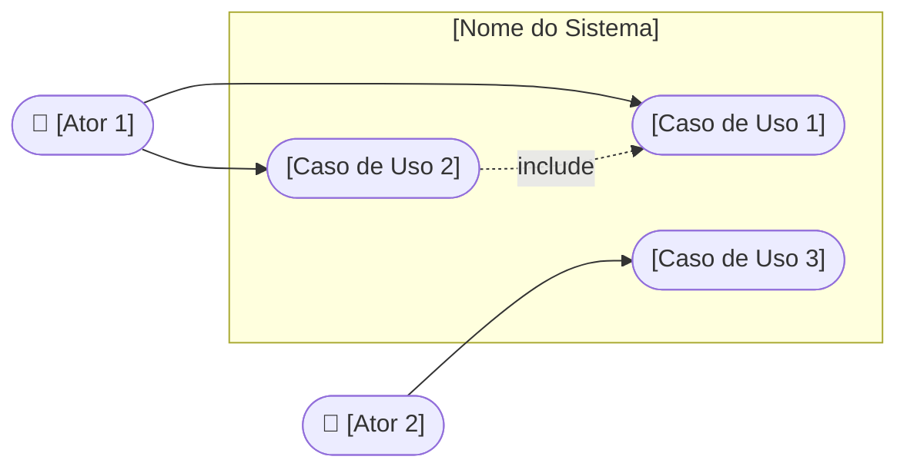
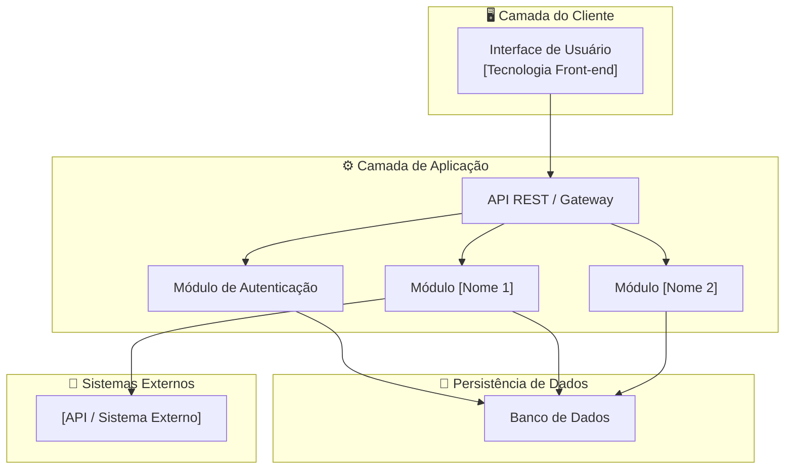
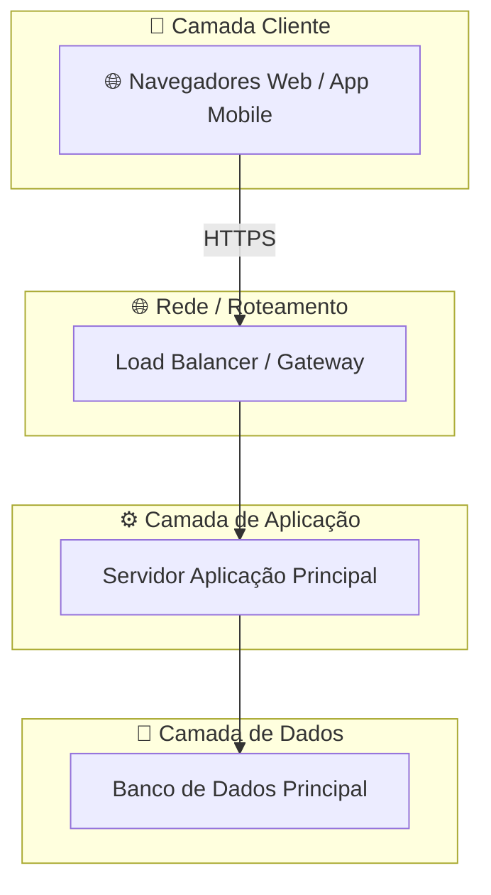
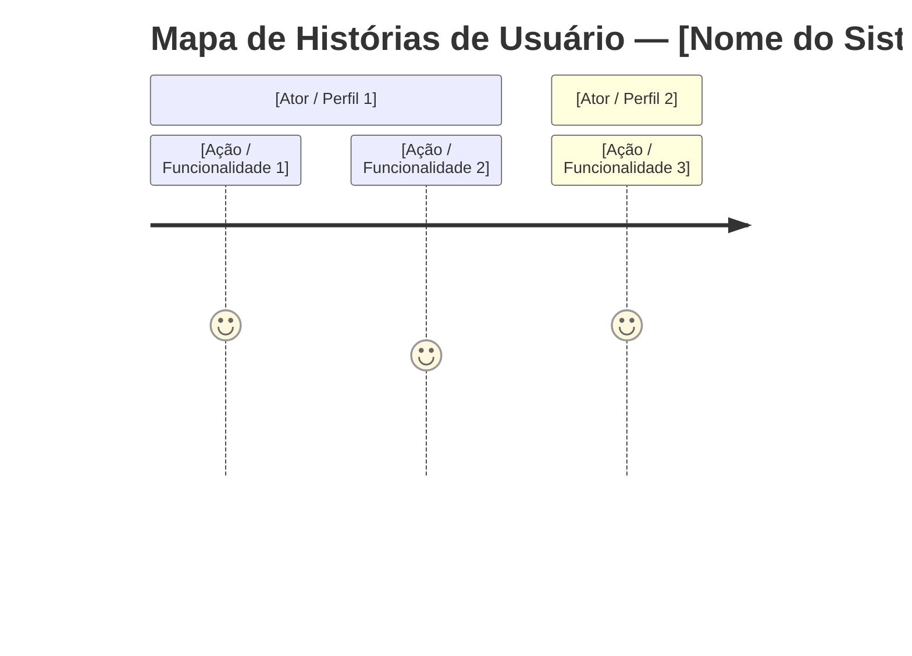

# Visão da Demanda (VD)

> **[Nome do Sistema / Projeto]**

## Histórico de Versões

| Data       | Versão | Descrição                                      | Autor             |
| ---------- | ------ | ---------------------------------------------- | ----------------- |
| 29/10/2026 | 1.0    | Criação inicial do documento de visão para o Sistema de Gestão das Feiras Livres	 | Equipe 3: Nicholas |

## 1. Objetivo

[Descrever o objetivo do documento e do sistema de forma clara e direta. Exemplo: Definir a proposta de valor e o escopo do [Nome do Sistema], detalhando as necessidades da [Área Solicitante/Cliente], dos [Usuários Finais] e demais partes interessadas.]

## 2. Proposta de Valor

[Apresentar os benefícios esperados com a implementação do sistema, destacando o que será modernizado, otimizado ou resolvido. Exemplo: O sistema permitirá [benefício principal], facilitando [atividades principais]. Espera-se [resultados esperados, ex: maior transparência, agilidade e redução de erros].]

## 3. Descrição da Demanda

[Descrever o contexto geral do funcionamento da solução. Quais processos serão apoiados, como os usuários utilizarão a ferramenta, os principais recursos esperados e as diretrizes gerais de acesso/segurança.]

## 4. Partes Interessadas

| Nome                        | Papel           | Responsabilidades                                 | Representante           |
|-----------------------------|-----------------|---------------------------------------------------|-------------------------|
| [Nome do Grupo / Área]      | [Cliente / Stakeholder / Dev] | [Descrever as principais responsabilidades]        | [Nome do Responsável]   |
| [Nome do Grupo / Área]      | [Usuário Final / Operador]    | [Descrever as principais responsabilidades]        | [Nome / Traço]          |

## 5. Personas

### 5.1. [Nome da Persona 1 - Ex: Usuário Operacional]
- **Descrição:** [Breve descrição do perfil, hábitos e características do usuário].
- **Objetivo:** [Principal necessidade ou objetivo que essa persona quer alcançar ao usar o sistema].

### 5.2. [Nome da Persona 2 - Ex: Gestor / Fiscal]
- **Descrição:** [Breve descrição do perfil, hábitos e características do usuário].
- **Objetivo:** [Principal necessidade ou objetivo que essa persona quer alcançar ao usar o sistema].

## 6. Necessidades e Funcionalidades

### Necessidade 1: [Nome do Agrupamento de Necessidade 1]

> **Nota:** Os termos específicos do domínio podem ser consultados no [glossário do projeto](link-para-o-glossario.md).

#### F1.1 [Nome da Funcionalidade 1.1]
- **Descrição:** [Descrição do que a funcionalidade realiza].
- **[Incluída / Fora do Escopo]**
- **Atores:** [Quem executa ou interage com esta funcionalidade]
- **Frequência:** [Alta / Média / Baixa / Mensal / Eventual]
- **Valor:** [Alto / Médio / Baixo]

#### F1.2 [Nome da Funcionalidade 1.2]
- **Descrição:** [Descrição do que a funcionalidade realiza].
- **[Incluída / Fora do Escopo]**
- **Atores:** [Quem executa ou interage com esta funcionalidade]
- **Frequência:** [Alta / Média / Baixa]
- **Valor:** [Alto / Médio / Baixo]

### Necessidade 2: [Nome do Agrupamento de Necessidade 2]

#### F2.1 [Nome da Funcionalidade 2.1]
- **Descrição:** [Descrição do que a funcionalidade realiza].
- **[Incluída / Fora do Escopo]**
- **Atores:** [Ator principal]
- **Frequência:** [Alta / Média / Baixa]
- **Valor:** [Alto / Médio / Baixo]

### Necessidade 3: Segurança, Desempenho e Conformidade

#### F3.1 Autenticação e Controle de Acesso
- **Descrição:** [Garantir acesso seguro e restrito a perfis autorizados].
- **Incluída**
- **Atores:** [Atores afetados]
- **Frequência:** Sempre
- **Valor:** Alto

#### F3.2 Requisito de Desempenho
- **Descrição:** [Ex: O tempo de resposta para operações principais deve ser de até X segundos].
- **Incluída**
- **Atores:** Todos
- **Frequência:** Sempre
- **Valor:** Alto

## 7. Arquitetura da Demanda

[Descrição em alto nível dos componentes do sistema, tecnologias previstas (web/mobile, banco de dados) e integrações com sistemas externos ouLegados.]

### 7.1. Diagramas UML

#### 7.1.1. Diagrama de Caso de Uso

#### 7.1.2. Diagrama de Componentes

#### 7.1.3. Diagrama de Implantação

### Mapa de Histórias de Usuário

---

## Checklist de Validação do Documento de Visão

- [ ] O objetivo está claro e alinhado ao problema/necessidade?
- [ ] A proposta de valor é mensurável e relevante?
- [ ] Todas as partes interessadas estão listadas com papéis definidos?
- [ ] Existem pelo menos duas personas descritas?
- [ ] Todas as necessidades e funcionalidades estão relacionadas a atores?
- [ ] Há indicação de valor e frequência para cada funcionalidade?
- [ ] A arquitetura está ilustrada com os diagramas UML (Caso de Uso, Componentes e Implantação)?
- [ ] O documento está escrito em linguagem clara e objetiva?

---

> Referência: Guia de Elaboração de Visão da Demanda.
